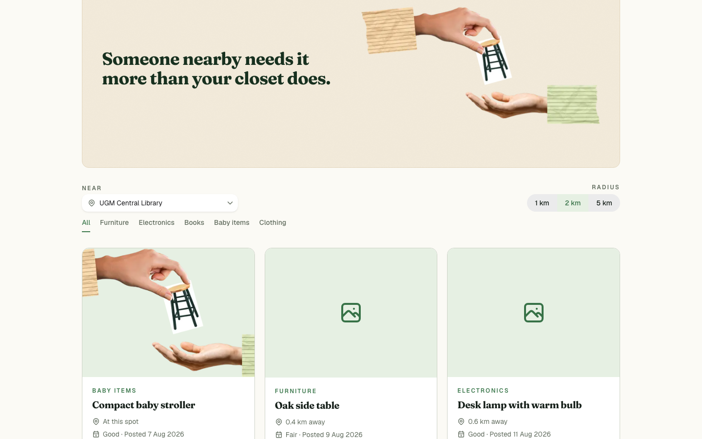
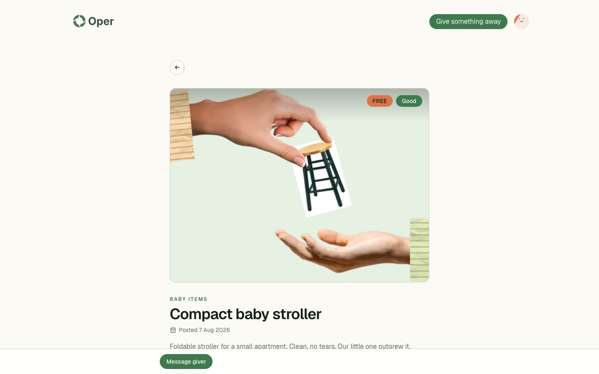
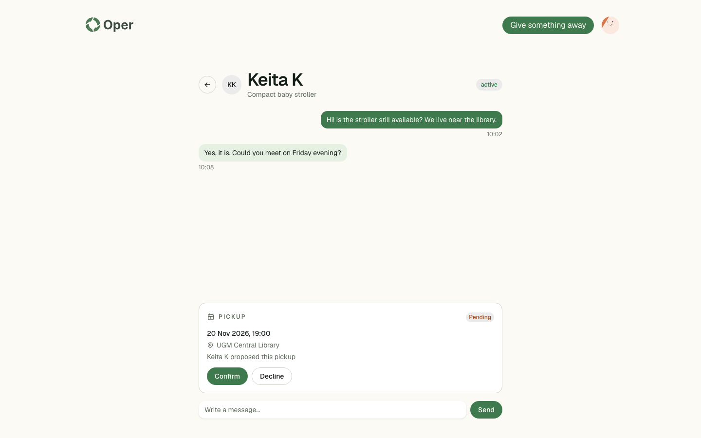
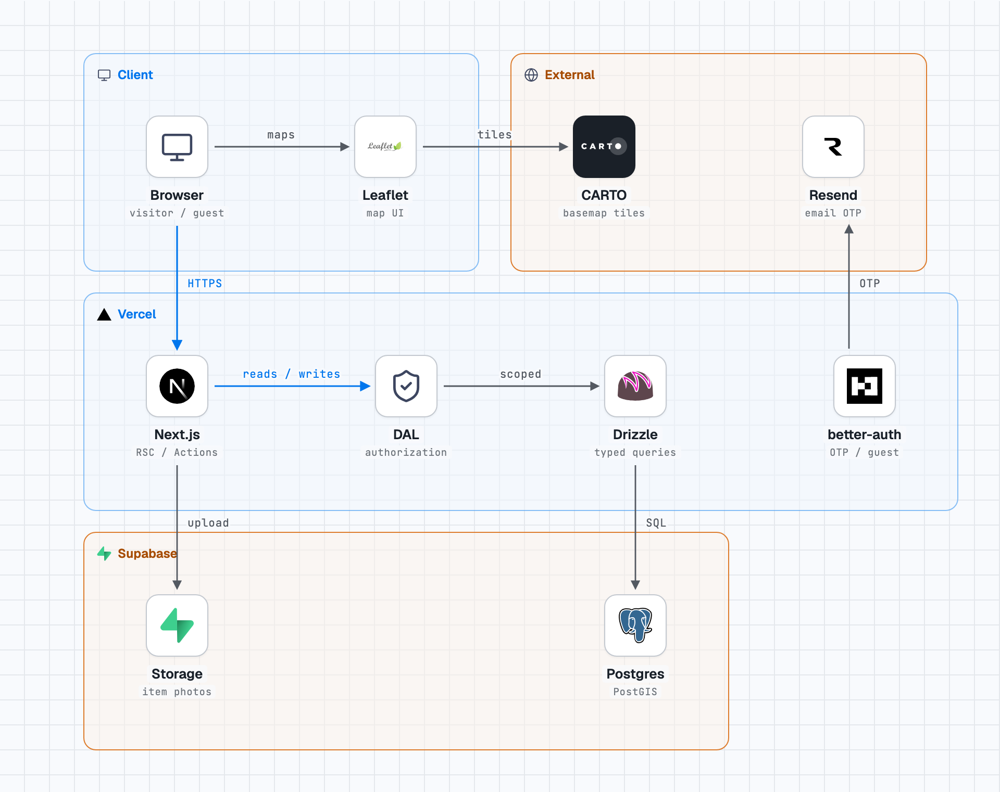

# oper

**A neighborhood marketplace for passing things on.**
Post what you no longer need, find people nearby who do, and arrange a pickup without the awkwardness.

A one-day working prototype and design case study — not a product under active development.

[Live demo](https://oper-gray.vercel.app/) · [Source](https://github.com/un-null/oper) · 

---

## Why

Most "give away" flows live inside chaotic group chats and social feeds. oper keeps the whole loop in one place: discover items within a radius, message the giver, agree on a pickup spot, confirm the handover, and leave a rating.

The interesting part is not the feature list but where the hard decisions live: authorization in the data-access layer, a pickup as an explicit state transition, and location privacy at the database boundary. See [Design decisions](#design-decisions).

## Screenshots

Browse items near a pickup spot, filtered by radius and category:



Item detail with photo, condition, pickup-spot hint, and the message call to action:



Conversation thread with an embedded pickup proposal:



## Design decisions

1. **Authorization lives in the DAL, not in the UI, middleware, or RLS.** Hiding a button is not access control. Every DAL function receives the viewer id and filters by ownership or participation, so a Server Action cannot accidentally widen access. A real-database test suite pins down the rules: only an owner can edit an item, only participants can read a conversation, and only a completed pickup can be rated.
2. **A pickup is an explicit state transition, not a flag on the item.** `pickups` owns proposed / confirmed / completed / cancelled, with the shared time and spot; the item moves active → pending → given in the same transaction as the pickup change. Completing a pickup is the only moment that unlocks rating, so the state change and the rating rules stay in one place. The trade-off is one more table and a careful write path.
3. **Location stays in PostGIS; distance is rounded before it reaches the client.** `ST_DWithin` + a GiST index keep radius queries fast, and the DAL never selects the raw `items.location` for browsing — it returns a distance rounded to 0.1 km. Exact addresses are never shown; handovers happen at shared public spots. The trade-off is reduced precision for a cleaner privacy story.
4. **Server Components read, Server Actions write.** There is no client-side data-fetching layer and no REST API to keep in sync; the only API route is the better-auth handler. Form input is validated with hand-written Zod schemas at the Server Action boundary (`src/lib/validation.ts`) because form strings and date/time inputs do not map 1:1 to Drizzle column types. The trade-off is limited optimistic UI.

## Architecture



```
src/app/         routes, layouts, server actions
src/components/  UI primitives and feature components
src/db/          schema and DAL
src/lib/         auth, storage, validation, formatting
drizzle/         SQL migrations
e2e/             Playwright specs
docs/images/     architecture diagram and screenshots
```

## Data model

| Table | Purpose |
|---|---|
| `profiles` | Display name, student / phone verification flags, rating aggregates |
| `items` | Listing, category, condition, pickup spot, `geometry(Point, 4326)` location |
| `item_photos` | Ordered photos per item |
| `conversations` | One thread per item × receiver |
| `messages` | Messages within a conversation |
| `pickups` | Proposed / confirmed / cancelled / completed handovers, with a shared time |
| `ratings` | Bidirectional (rater → ratee), one per rater per completed pickup |

Auth tables (`user`, `session`, `account`, `verification`) are managed by better-auth. There is no stored avatar and no stored availability column: avatars are generated from initials, and availability is implied by the pickup state.

## Features

- Browse items near a pickup spot (1 / 2 / 5 km) and message the giver — guests can join without email.
- One conversation per item; propose, confirm, complete or cancel a pickup at a public spot, then rate each other.
- Photos in Supabase Storage; student email OTP for verified profiles, generated avatars otherwise.
- Keyboard-first UI with visible focus and labelled controls.

## Tech stack

| Layer | Choice |
|---|---|
| Framework | Next.js 16 (App Router, RSC, Server Actions) |
| UI | React 19, HeroUI v3, react-aria-components, Tailwind CSS 4 |
| Data | PostgreSQL + PostGIS, Drizzle ORM, hand-written Zod validation |
| Auth | better-auth (student email OTP + anonymous guest sessions) |
| Storage | Supabase Storage (item photos) |
| Email | Resend |
| Maps | Leaflet / react-leaflet with CARTO basemap tiles |
| Quality | Biome, Vitest, Playwright, unlighthouse |

## Testing

- **Unit / integration** — Vitest against the DAL, validation, browse params, pickup spots, labels
- **E2E** — 8 Playwright tests covering guest sign-in, posting an item, browse filters, the onboarding redirect, and message replies
- **Performance** — unlighthouse config for repeatable local audits

```bash
pnpm test
pnpm test:e2e
```

## Status

Live on Vercel. Single region, no moderation, no seed data. CI runs lint, unit/integration tests, and build on every push.

## AI assistance

Parts of this codebase were built with AI assistance. I reviewed the generated code myself, and the authorization and data-access layers are covered by tests so their behavior can be verified rather than assumed.

---

## Development

Requirements: Node.js (developed on 24; no `engines` pin), pnpm 11.13, PostgreSQL 15+ with PostGIS.

```bash
pnpm install
cp .env.example .env    # fill in the values
pnpm db:migrate
pnpm dev
```

The migrations do not create PostGIS, so enable it once on the target database:

```sql
CREATE EXTENSION IF NOT EXISTS postgis;
```

All seven required keys are listed in [`.env.example`](.env.example).

Only the non-obvious scripts are worth calling out: `pnpm db:migrate` applies SQL migrations (PostGIS first), `pnpm test:e2e` needs Resend and Supabase credentials, and `pnpm lighthouse` runs a local performance audit. The rest are in `package.json`.
